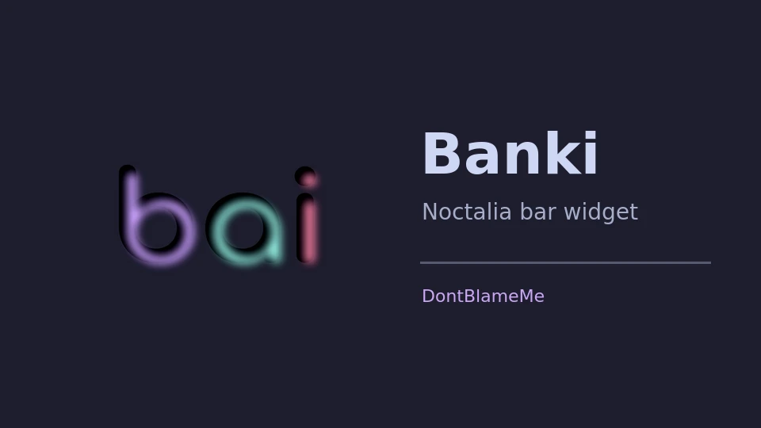

# Banki



A Noctalia bar widget that reads due Anki cards from a local collection. It
shows the number learnable right now from the local collection.
Anki does not need to run. AnkiWeb sync is optional.

## Install

```sh
noctalia msg plugins source add banki git https://github.com/DontBlameMeDev/banki.git
noctalia msg plugins enable dontblameme/banki
```

Then add `dontblameme/banki:banki` to a bar.

See [banki/README.md](banki/README.md) for behavior, settings, and performance
notes.

## Development

See [docs/noctalia-plugins.md](docs/noctalia-plugins.md) for the Noctalia plugin
API documentation links used by this plugin.
