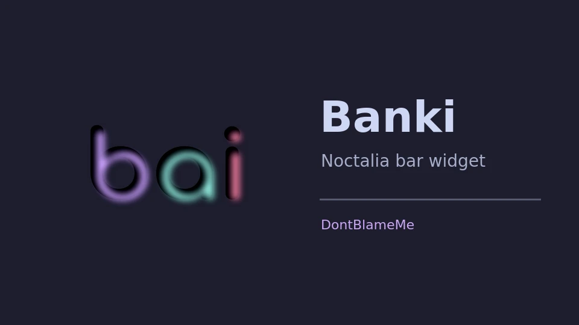

# Banki

Banki is a bare Noctalia bar widget plugin. The Luau entry is empty while the
widget behavior is still being designed.

## Plugin

| Field | Value |
| --- | --- |
| ID | `dontblameme/banki` |
| Entries | Bar widget: `banki` |

## Requirements

The plugin requires a Noctalia release with plugin API 48 or newer.

## Usage

Add the `dontblameme/banki:banki` widget to a bar. It renders nothing until the
entry script is implemented.
